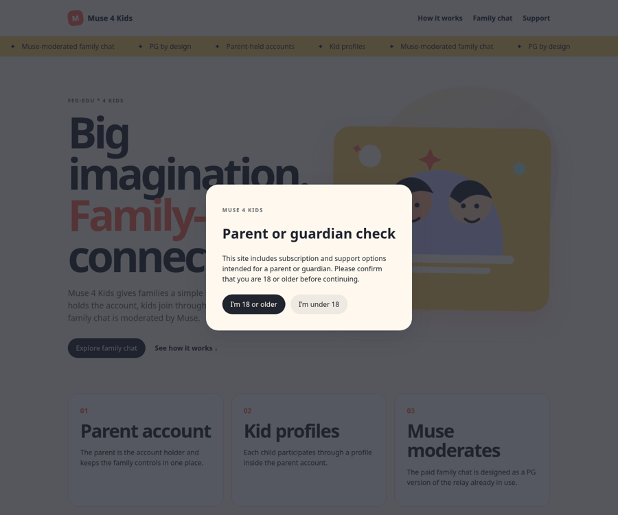
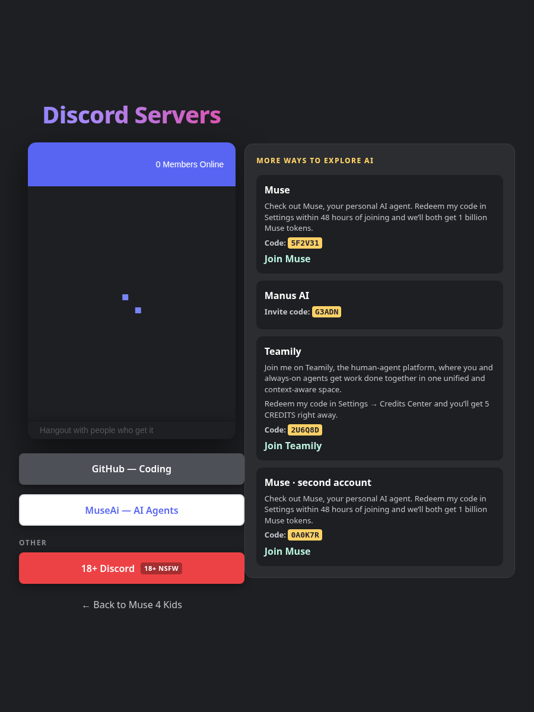

# Muse 4 Kids

A parent-held family experience prototype with kid profiles and an optional Muse-moderated family chat.

> **FED-EDU * 4 KIDS** is the associated workstream label. The repository and product identity are **Muse 4 Kids**.

## Why this exists

Families need a simpler way to share a child-appropriate conversation without turning a kid into a separate account holder. In this project, the parent owns the account, each child participates through a profile, and the optional family chat is designed as a PG version of the relay already in use.

The repository is intentionally small and transparent: a product brief, requirements, proposed data model, safety posture, roadmap, and a static HTML prototype. WhatsApp, SMS, and other external messaging integrations are explicitly test-later and are not advertised as available features.

## See it work

**Live demo:** no live deployment is currently configured or confirmed. The repository contains Cloudflare Pages-compatible `_headers` and `_redirects` files, but there is no GitHub Actions workflow, `wrangler.toml`, or published demo URL in this repository.

**Fastest local demo:**

```bash
python3 -m http.server 8000 --directory site
```

Then open [http://localhost:8000](http://localhost:8000) and choose **I’m 18 or older** to inspect the payment/support sections. The direct entry point is [`site/index.html`](site/index.html). The dedicated Discord page is [`site/discord.html`](site/discord.html).

### Two-frame site tour



### Real screenshots

The screenshots below were captured from the actual static site served locally; they are not mockups.

| Homepage age gate | Discord servers page |
|---|---|
|  |  |

## Quick start

No package manager or build step is required. This is a static HTML/CSS/JavaScript site.

```bash
# clone or download the repository, then enter it
cd muse-4-kids-bundle

# run the local demo
python3 -m http.server 8000 --directory site

# open the site
# http://localhost:8000
```

There is currently no automated test command. A lightweight manual smoke test is to open `site/index.html`, verify the age gate, follow the local HTML routes, open `site/discord.html`, and confirm that the favicon and promotional artwork load.

## What is in the repository

| Path | Purpose |
|---|---|
| [`site/index.html`](site/index.html) | Main static landing page and quickest working demo |
| [`site/discord.html`](site/discord.html) | Centered Discord widget, server buttons, and 18+ age gate |
| [`site/styles.css`](site/styles.css) | Responsive layout, animation, promo-card styling, and footer styling |
| [`site/app.js`](site/app.js) | Session-only parent/guardian age-gate behavior on the main page |
| [`site/assets/`](site/assets/) | Favicon and original simple comic-style promotional SVGs |
| [`site/payment-success.html`](site/payment-success.html) | HTML destination after a successful payment-provider response |
| [`site/payment-cancelled.html`](site/payment-cancelled.html) | HTML destination when checkout is paused or cancelled |
| [`site/support.html`](site/support.html) | Support and external-link page |
| [`site/404.html`](site/404.html) | HTML fallback for missing routes on static hosts |
| [`site/_headers`](site/_headers) | Cloudflare Pages response headers |
| [`site/_redirects`](site/_redirects) | Cloudflare Pages route rules |
| [`product/`](product/) | Product brief and initial requirements |
| [`data/data-model.md`](data/data-model.md) | Proposed conceptual data model |
| [`policy/moderation-and-safety.md`](policy/moderation-and-safety.md) | Initial moderation and safety posture |
| [`docs/roadmap.md`](docs/roadmap.md) | Phased product roadmap |

## Scope and important limitations

The current repository is a prototype and documentation bundle, not a production service. The supplied PayPal and Stripe snippets are embedded in the static homepage, but production billing still needs server-side entitlement confirmation, webhook handling, refund/cancellation behavior, legal copy, and an approved parental-consent flow.

The age gate is a user-interface gate, not legal age verification. The moderation document is an initial posture, not a completed child-safety policy. Pricing, age bands, retention, escalation, regional availability, and final permissions remain open decisions.

No package metadata, license file, automated test suite, CI workflow, published deployment, or confirmed live demo was found during repository inspection. These are intentionally not represented as available project features.

## Deployment notes

The site can be hosted as static files because `site/` contains the HTML entry point, assets, `_headers`, `_redirects`, and a `404.html` fallback. GitHub Pages and Cloudflare Pages are plausible hosting targets, but neither is enabled or verified in this repository. A deployment workflow, custom domain, and live URL should be added only after the hosting choice is confirmed.

## Product decisions captured here

- The parent is the account holder.
- A kid is a profile inside the parent account.
- The paid upsell is a family chat with Muse moderating it.
- The family chat is intended to be a PG version of the relay already in use.
- WhatsApp, SMS, and other integrations are test-later and not advertised yet.
- The repository and image say **Muse 4 Kids**.

## Contributing and status

This bundle is currently a product and static-site prototype. Before production work begins, the next useful steps are to confirm the safety/consent model, choose and configure a hosting target, define payment webhooks and entitlements, and add automated checks for HTML routes and accessibility.
